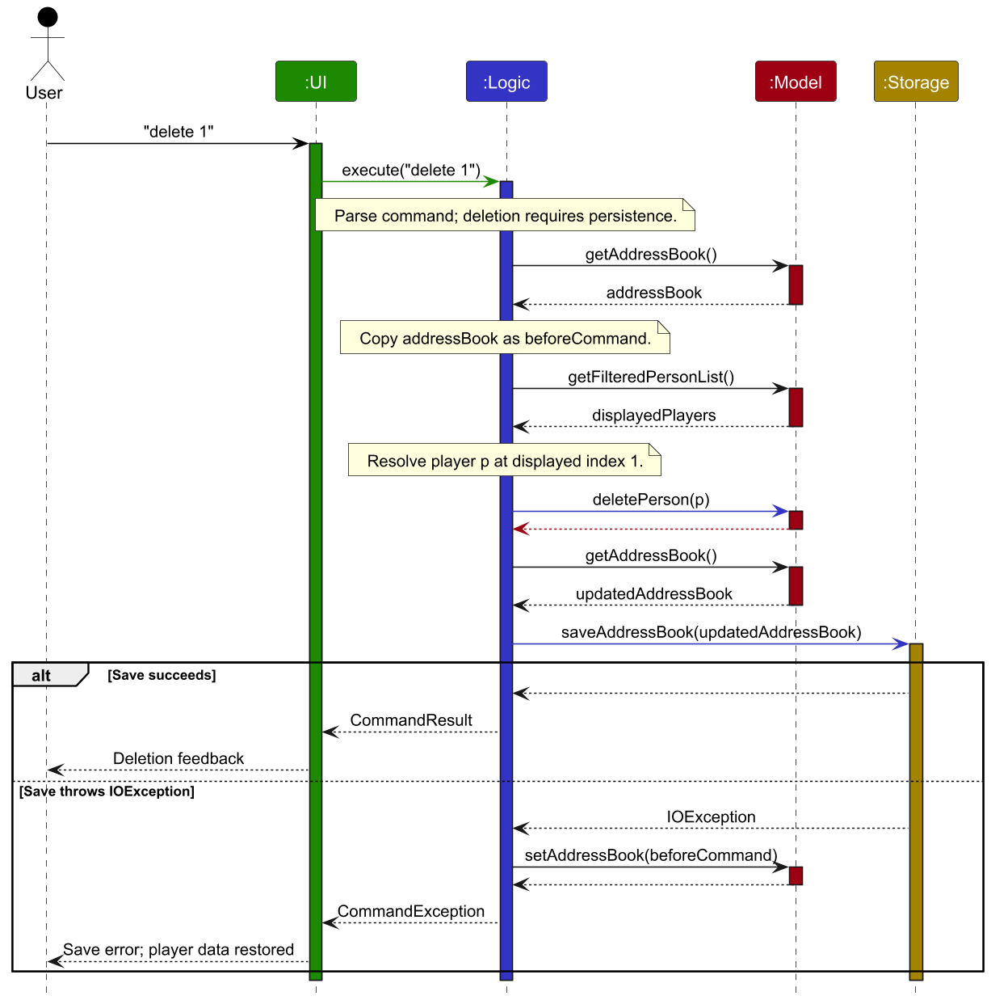
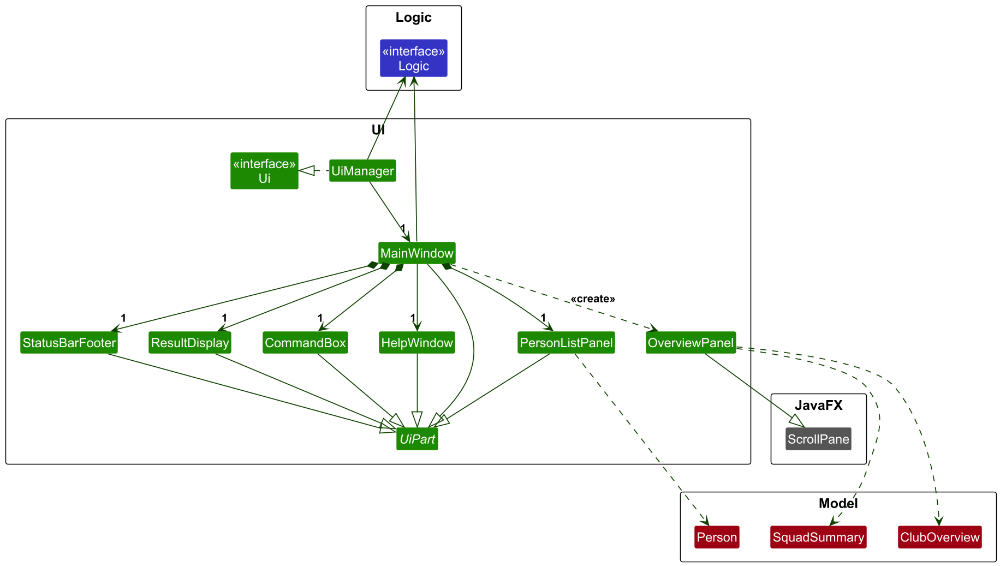
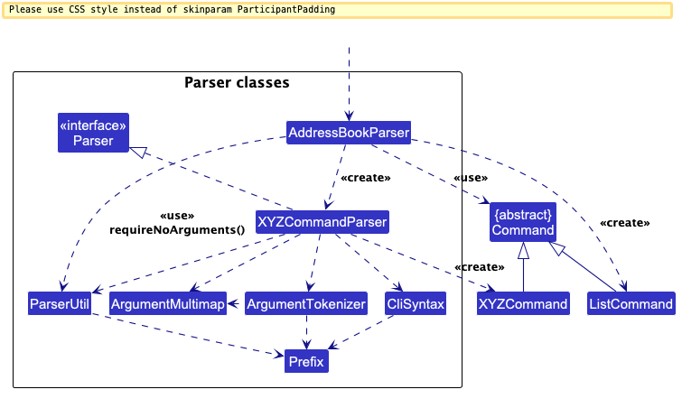
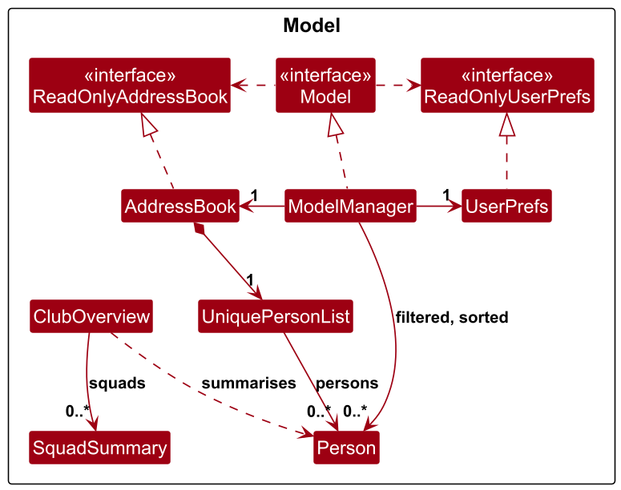
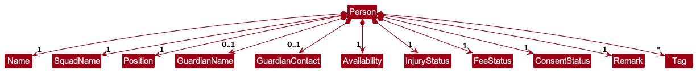
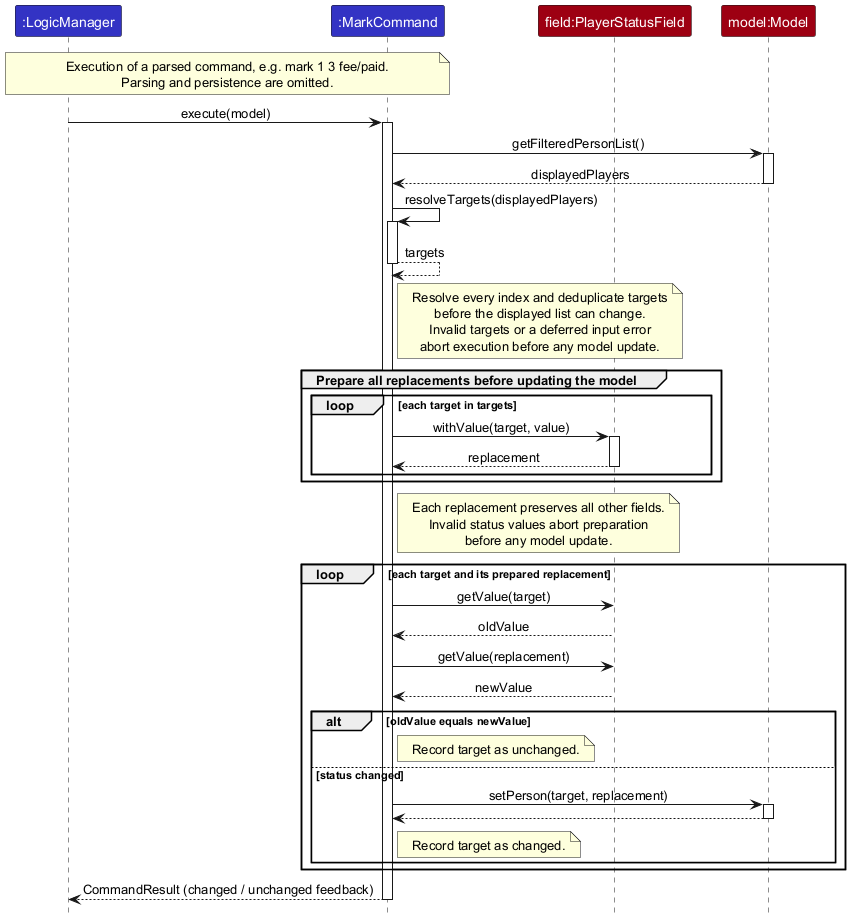

* Table of Contents
{:toc}

--------------------------------------------------------------------------------------------------------------------

## **Acknowledgements**

* _{List the sources of reused or adapted ideas, code, documentation, and third-party libraries here, with links to the originals.}_

--------------------------------------------------------------------------------------------------------------------

## **Setting up, getting started**

Refer to the guide [_Setting up and getting started_](SettingUp.md).

--------------------------------------------------------------------------------------------------------------------

## **Design**

:bulb: **Tip:** The `.puml` files used to create diagrams are in `docs/diagrams`. Refer to the [_PlantUML Tutorial_ at se-edu/guides](https://se-education.org/guides/tutorials/plantUml.html) to learn how to create and edit diagrams.

### Architecture

The ***Architecture Diagram*** given above explains the high-level design of the App.

The following provides a quick overview of the main components and their interactions.

**Main components of the architecture**

**`Main`** (consisting of classes [`Main`](https://github.com/se-edu/addressbook-level3/tree/master/src/main/java/seedu/address/Main.java) and [`MainApp`](https://github.com/se-edu/addressbook-level3/tree/master/src/main/java/seedu/address/MainApp.java)) is in charge of the app launch and shut down.
* At app launch, it initializes the other components in the correct sequence, and connects them up with each other.
* At shut down, it shuts down the other components and invokes cleanup methods where necessary.

The bulk of the app's work is done by the following four components:

* [**`UI`**](#ui-component): The UI of the App.
* [**`Logic`**](#logic-component): The command executor.
* [**`Model`**](#model-component): Holds the data of the App in memory.
* [**`Storage`**](#storage-component): Reads data from, and writes data to, the hard disk.

[**`Commons`**](#common-classes) represents a collection of classes used by multiple other components.

**How the architecture components interact with each other**

The *Sequence Diagram* below shows how the components interact for a valid `delete 1` command,
including recovery if saving fails. Interactions within `Logic` are collapsed into one lifeline.
Before executing a mutating command, `LogicManager` copies the player data. If storage throws
an `IOException`, it restores that data and reports a save error instead of deletion success.

Each of the four main components (also shown in the diagram above),

* defines its *API* in an `interface` with the same name as the Component.
* provides its functionality through a concrete `{Component Name}Manager` class that implements the corresponding API interface.

For example, the `Logic` component defines its API in `Logic.java` and implements it in `LogicManager.java`. Other components interact with a component through its interface rather than its concrete class, preventing them from coupling to that component's implementation, as illustrated in the following partial class diagram.

The sections below give more details of each component.

### UI component

The **API** of this component is specified in [`Ui.java`](https://github.com/se-edu/addressbook-level3/tree/master/src/main/java/seedu/address/ui/Ui.java)

The UI consists of a `MainWindow` and its parts, such as `CommandBox`, `ResultDisplay`, `PersonListPanel`, and `StatusBarFooter`. All of these, including `MainWindow`, inherit from the abstract `UiPart` class, which captures common behavior among classes that represent visible GUI parts.

`PersonListPanel` displays players in a table. For an `overview` result, `MainWindow` creates an `OverviewPanel` using the `ClubOverview` snapshot and replaces the table view with it. `OverviewPanel` extends JavaFX `ScrollPane` and builds its display from `ClubOverview` and `SquadSummary` data. The `main` command restores the existing player table with its current filter and sort order.

The `UI` component uses the JavaFX UI framework. The layouts of the `UiPart` subclasses are defined in matching `.fxml` files in `src/main/resources/view`; `OverviewPanel` builds its layout in Java. For example, [`MainWindow.fxml`](https://github.com/se-edu/addressbook-level3/tree/master/src/main/resources/view/MainWindow.fxml) specifies the layout of [`MainWindow`](https://github.com/se-edu/addressbook-level3/tree/master/src/main/java/seedu/address/ui/MainWindow.java).

The `UI` component,

* executes user commands using the `Logic` component.
* listens for changes to `Model` data so that the UI can be updated with the modified data.
* keeps a reference to the `Logic` component, because the `UI` relies on the `Logic` to execute commands.
* depends on some classes in the `Model` component because it displays players from the model.

### Logic component

**API** : [`Logic.java`](https://github.com/se-edu/addressbook-level3/tree/master/src/main/java/seedu/address/logic/Logic.java)

Here's a (partial) class diagram of the `Logic` component:

The sequence diagram below illustrates the interactions within the `Logic` component, taking `execute("delete 1")` API call as an example.

For `delete 1`, `LogicManager` first snapshots the address book. `DeleteCommand` then obtains the currently
displayed player list from the `Model`, resolves the index against that list, and deletes the selected player.
`LogicManager` saves the updated address book through `Storage`; if saving fails, it restores the snapshot and
returns an error instead of the command result.

:information_source: **Note:** The lifeline for `DeleteCommandParser` should end at the destroy marker (X), but due to a limitation of PlantUML, it continues to the end of the diagram.

How the `Logic` component works:

1. When `Logic` is called upon to execute a command, the command is passed to an `AddressBookParser` object, which in turn creates a parser that matches the command (e.g., `DeleteCommandParser`) and uses it to parse the command.
1. This results in a `Command` object (more precisely, an object of one of its subclasses e.g., `DeleteCommand`) which is executed by the `LogicManager`.
1. The command can communicate with the `Model` when it is executed (e.g. to delete a player). 
   Note that although this is shown as a single step in the diagram above for simplicity, the code can require several interactions between the command object and the `Model` to complete the operation.
1. The result of the command execution is encapsulated as a `CommandResult` object which is returned from `Logic`.
   For commands whose `isAddressBookMutating()` returns `true`, `LogicManager` saves the data
   before returning the result and restores the pre-command snapshot if saving fails.
   Non-mutating commands, such as `overview` and `sort`, skip the snapshot and save.

Here are the other classes in `Logic` (omitted from the class diagram above) that are used for parsing a user command:

How the parsing works:
* When called upon to parse a user command, the `AddressBookParser` class creates an `XYZCommandParser` (`XYZ` is a placeholder for the specific command name, e.g., `AddCommandParser`). The parser uses the other classes shown above to parse the user command and create an `XYZCommand` object (e.g., `AddCommand`). The `AddressBookParser` returns that object as a `Command` object.
* All `XYZCommandParser` classes, such as `AddCommandParser` and `DeleteCommandParser`, implement the `Parser` interface so they can be treated similarly where appropriate, for example during testing.

### Model component
**API** : [`Model.java`](https://github.com/se-edu/addressbook-level3/tree/master/src/main/java/seedu/address/model/Model.java)

The model class diagram above shows the main roster, player-view, overview, and user-preference classes.
It omits individual player fields for clarity; the detailed player data model below expands `Person`.

The `Model` component,

* stores the roster data i.e., all player records (`Person` objects, contained in a `UniquePersonList` object).
* stores the player records selected by the current filter, such as search results, in a separate _filtered_ list.
  A _sorted_ view is layered over it for the `sort` command. The model exposes this unmodifiable
  `ObservableList<Person>` to the UI, so the UI updates when the filter or sort order changes.
* stores a `UserPrefs` object that represents the user’s preferences (currently, just the GUI settings). This is exposed to the outside as a `ReadOnlyUserPrefs` object.
* does not depend on any of the other three components (as the `Model` represents data entities of the domain, they should make sense on their own without depending on other components)

:information_source: **Note:** The alternative, arguably more object-oriented, design below keeps a unique list of tags in `AddressBook`, and each player references tags from that list. This lets `AddressBook` maintain one `Tag` object per unique tag instead of each player holding their own `Tag` objects. 

### Storage component

**API** : [`Storage.java`](https://github.com/se-edu/addressbook-level3/tree/master/src/main/java/seedu/address/storage/Storage.java)

The `Storage` component,
* can save both address book data and user preference data in JSON format, and read them back into corresponding objects.
* is implemented by `StorageManager`, which delegates the actual JSON file access to `JsonAddressBookStorage` and `JsonUserPrefsStorage` (one class per data file).
* depends on some classes in the `Model` component (because the `Storage` component's job is to save/retrieve objects that belong to the `Model`)

### Common classes

Classes used by multiple components are in the `seedu.address.commons` package.

--------------------------------------------------------------------------------------------------------------------

## **Implementation**

This section describes some noteworthy details on how certain features are implemented.

### Command validation and error feedback

Command parsers validate command syntax and individual field values before creating a command.
Invalid input results in a `ParseException`, which `LogicManager` propagates for the UI to display without changing model data.
Commands validate runtime-dependent conditions, such as whether an index exists in the current filtered list, during execution.
These failures result in a `CommandException`, which is likewise displayed without changing the model.
User-facing validation messages are defined centrally in `Messages` when they are shared by multiple commands, preventing inconsistent feedback.

### Bulk player status updates

`MarkCommandParser` parses displayed indexes and exactly one status prefix into a `MarkCommand`. It reuses
`ParserUtil.parsePlayerIndex` and the existing status types for validation. CLI availability values (`true`/`false`
or `available`/`unavailable`) are mapped to the domain values (`available`/`unavailable`).

`MarkCommand` resolves all indexes to distinct player objects before preparing replacements through
`PlayerStatusField.withValue`. All targets and replacements are validated before model updates begin, preventing
partial changes from invalid input and index shifts when a filter shrinks. Only changed records are replaced;
feedback separates changed and unchanged players. The active filter remains in place.

The sequence diagram below focuses on command execution after parsing. Resolving targets and preparing all
replacements before the first `setPerson` call keeps later selections stable even if an update removes a player
from the filtered view. Parsing and persistence are omitted to keep the diagram focused.

`PlayerStatusField` copies every other profile field unchanged, keeping injury independent of availability.
The command uses `LogicManager`'s existing save-and-rollback mechanism. Parser and command tests cover input and
selection behavior; `MarkIntegrationTest` verifies command routing, all four statuses, save/reload and rollback.

### Undo/redo feature

#### Implementation

The undo/redo mechanism is facilitated by `VersionedAddressBook`. It extends `AddressBook` with an undo/redo history, stored internally as an `addressBookStateList` and `currentStatePointer`.

Additionally, `VersionedAddressBook` implements the following operations:

* `VersionedAddressBook#commit()` — Saves the current address book state in its history.
* `VersionedAddressBook#undo()` — Restores the previous address book state from its history.
* `VersionedAddressBook#redo()` — Restores a previously undone address book state from its history.
* `VersionedAddressBook#canUndo()` — Returns true if there are address book states before the current state pointer.
* `VersionedAddressBook#canRedo()` — Returns true if there are address book states after the current state pointer.

These operations are exposed through the `Model` interface as:
* `Model#commitAddressBook()`
* `Model#undoAddressBook()`
* `Model#redoAddressBook()`
* `Model#canUndoAddressBook()`
* `Model#canRedoAddressBook()`

`ModelManager` implements these methods by delegating directly to its internal `VersionedAddressBook` instance and refreshing the filtered person list via `updateFilteredPersonList(PREDICATE_SHOW_ALL_PERSONS)` after every undo or redo operation.

Command arguments are validated in `AddressBookParser` using `ParserUtil.requireNoArguments(arguments, UndoCommand.MESSAGE_USAGE)` and `ParserUtil.requireNoArguments(arguments, RedoCommand.MESSAGE_USAGE)` to reject extraneous parameters before execution.

Given below is an example usage scenario and how the undo/redo mechanism behaves at each step.

**Step 1.** The user launches the application for the first time. The `VersionedAddressBook` is initialized with the initial address book state, and the `currentStatePointer` points to that single address book state (index `0`).

Step 2. The user executes `delete 5` command to delete the 5th player in the address book. The `delete` command calls `Model#commitAddressBook()`, causing the modified state of the address book after the `delete 5` command executes to be saved in the `addressBookStateList`, and the `currentStatePointer` is shifted to the newly inserted address book state.

Step 3. The user executes `add n/David …​` to add a new player. The `add` command also calls `Model#commitAddressBook()`, causing another modified address book state to be saved into the `addressBookStateList`.

:information_source: **Note:** If a command fails its execution (such as invalid arguments or a duplicate player error), it will not call `Model#commitAddressBook()`, ensuring the failed state is never recorded in `addressBookStateList`.

**Step 4.** The user decides that adding the player was a mistake and executes the `undo` command.
1. `UndoCommand#execute(Model)` queries `Model#canUndoAddressBook()`.
2. Because `currentStatePointer > 0`, it calls `Model#undoAddressBook()`.
3. `VersionedAddressBook#undo()` decrements `currentStatePointer` once to the left (to index `1`) and calls `resetData(...)` to restore the address book to that state.
4. `ModelManager` calls `updateFilteredPersonList(PREDICATE_SHOW_ALL_PERSONS)` to show the updated roster.

:information_source: **Note:** If `currentStatePointer` is at index `0`, there are no prior states to restore. `Model#canUndoAddressBook()` returns `false`, causing `UndoCommand` to throw a `CommandException` with the message `There is no command to undo!`.

The sequence diagram below shows how an `undo` operation flows through the `Logic` and `Model` components:

**Step 5.** The user changes their mind and executes `redo`.
1. `RedoCommand#execute(Model)` queries `Model#canRedoAddressBook()`.
2. Because `currentStatePointer < addressBookStateList.size() - 1`, it calls `Model#redoAddressBook()`.
3. `VersionedAddressBook#redo()` increments `currentStatePointer` once to the right (back to index `2`) and restores the address book to that state.
4. `ModelManager` resets the view with `updateFilteredPersonList(PREDICATE_SHOW_ALL_PERSONS)`.

:information_source: **Note:** If `currentStatePointer` is at index `addressBookStateList.size() - 1`, pointing to the latest state in the list, `Model#canRedoAddressBook()` returns `false`. `RedoCommand` throws a `CommandException` with the message `There is no undo to redo.`

**Step 6.** The user executes `list` or `filter`. Commands that do not modify the stored address book data do not call `Model#commitAddressBook()`, `Model#undoAddressBook()`, or `Model#redoAddressBook()`. Thus, the `addressBookStateList` and `currentStatePointer` remain untouched.

**Step 7.** The user executes `clear` after having undone one state (at index `1`). The `clear` command calls `Model#commitAddressBook()`. Because `currentStatePointer` was not pointing to the end of `addressBookStateList`, all states ahead of `currentStatePointer` are purged before the new state is appended. This prevents an inconsistent redo path after a branching modification.

The following activity diagram summarizes what happens when a user executes a new command:

***

#### Design considerations:

**Aspect: How undo & redo execute:**

* **Alternative 1 (current choice):** Saves the entire `AddressBook` state snapshot on every commit.
    * Pros: Simple, resilient, and decoupled from individual command logic; commands only need to call `commitAddressBook()`.
    * Cons: Higher memory consumption if the number of stored states or roster size grows very large.
* **Alternative 2:** Individual commands implement their own reverse/inverse operations (memento/command pattern).
    * Pros: Lower memory footprint, as only deltas (e.g. the specific added or deleted `Person`) are saved.
    * Cons: Significantly higher implementation complexity and error surface; every mutating command must accurately define, test, and maintain an exact inverse operation.

### \[Proposed\] Data archiving

_{Explain here how the data archiving feature will be implemented}_

--------------------------------------------------------------------------------------------------------------------

## **Documentation, logging, testing, dev-ops**

* [Documentation guide](Documentation.md)
* [Testing guide](Testing.md)
* [Logging guide](Logging.md)
* [DevOps guide](DevOps.md)

--------------------------------------------------------------------------------------------------------------------

## **Appendix: Requirements**

### Product scope

**Target user profile**:

* is a coach or administrator of a football team or small football club
* manages a significant number of players, guardians, and other football-related contacts
* needs to frequently maintain, retrieve, filter, organise, and remove contact information
* prefers desktop applications and keyboard-driven workflows
* can type quickly and prefers typing to mouse interactions
* is reasonably comfortable using CLI-style applications

**Value proposition**: Help football coaches quickly organise, retrieve, and maintain player and contact information using CLI-style commands.

### User stories

Priorities: High (must have) - `***`, Medium (nice to have) - `**`, Low (unlikely to have) - `*`

| Priority | As a … | I want to … | So that I can… |
|----------| --- | --- | --- |
| `***`    | coach | add a player with their name, squad and position | keep track of the players I manage |
| `***`    | coach | record a player's availability | quickly see whether a player is available for selection |
| `***`    | coach | view a list of all registered players | get an overview of the players I manage |
| `***`    | coach | view the full details of a specific player | access more information about that player when needed |
| `***`    | coach | delete a player | remove players who are no longer relevant or were added by mistake |
| `**`     | coach | filter players by squad | quickly find players belonging to a particular squad |
| `**`     | coach | filter players by availability | quickly find players who are available or unavailable |
| `**`     | coach | sort the displayed roster | organise the players currently relevant to me |
| `**`     | first-time user | view help for the available commands | learn how to use the application without memorising every command |
| `*`      | coach | edit a player's details | correct or update information without deleting and re-adding the player |
| `*`      | coach | record additional player information such as skill level, injury status, consent status and fee status | keep more comprehensive information about each player |
| `*`      | coach | undo my previous command | quickly revert accidental edits or deletions |
| `*`      | coach | redo a previously undone command | restore changes without retyping the command |

### Use cases

(For all use cases below, the **System** is `SquadLink` and the **Actor** is the `Coach`, unless specified otherwise)

**Use case: Add a player**

**MSS**

1. Coach requests to add a player with their name, squad and position.
2. SquadLink validates the provided player details.
3. SquadLink adds the player.
4. SquadLink confirms that the player has been added.

    Use case ends.

**Extensions**

* 1a. One or more mandatory fields are missing.
  * 1a1. SquadLink shows an error message.

    Use case ends.

* 2a. One or more provided values are invalid.
  * 2a1. SquadLink shows an error message.

    Use case ends.

* 2b. The player is already registered.
  * 2b1. SquadLink shows an error message indicating that the player already exists.

    Use case ends.

**Use case: List all players**

**MSS**

1. Coach requests to list players.
2. SquadLink retrieves the registered players in the order they were added.
3. SquadLink displays the list of players showing their index, name, squad, position, and availability.

   Use case ends.

**Extensions**

* 1a. Coach provides extra arguments (e.g., `list abc`).
    * 1a1. SquadLink shows an error message indicating that additional arguments are not accepted.

      Use case ends.

* 2a. There are no registered players in SquadLink.
    * 2a1. SquadLink informs the Coach that no players are registered.

      Use case ends.

* 2b. SquadLink is unable to load player data from storage.
    * 2b1. SquadLink shows an error message indicating data loading failure.

      Use case ends.

**Use case: Delete a player**

**MSS**

1. Coach requests to list players.
2. SquadLink shows the list of registered players.
3. Coach requests to delete a specific player in the list.
4. SquadLink deletes the player and saves the updated player data.
5. SquadLink confirms that the player has been deleted.

    Use case ends.

**Extensions**

* 2a. The list is empty.
  * 2a1. SquadLink informs the Coach that there are no registered players.

    Use case ends.

* 3a. The given index is invalid.
  * 3a1. SquadLink shows an error message.

    Use case resumes at step 2.

* 4a. SquadLink is unable to save the updated player data.
  * 4a1. SquadLink shows an error message.
  * 4a2. SquadLink rolls back the deletion, and the player remains registered.

    Use case ends.

**Use case: View a player**

**MSS**

1. Coach requests to list players.
2. SquadLink shows the list of registered players.
3. Coach requests to view a specific player in the list.
4. SquadLink shows the player's details.

   Use case ends.

**Extensions**

* 2a. The list is empty.

  Use case ends.

* 3a. The given index is invalid.
    * 3a1. SquadLink shows an error message.

      Use case resumes at step 2.

**Use case: Filter players**

**MSS**

1. Coach requests to filter players using one or more criteria.
2. SquadLink validates the given filter criteria.
3. SquadLink shows players that match all the given criteria.

    Use case ends.

**Extensions**

* 1a. No filter criterion is provided.
  * 1a1. SquadLink shows an error message.

    Use case ends.

* 2a. A given filter criterion is invalid.
  * 2a1. SquadLink shows an error message.

    Use case ends.

* 3a. No players match the given criteria.
  * 3a1. SquadLink informs the coach that no matching players were found.

    Use case ends.

**Use case: Sort displayed players**

**MSS**

1. Coach requests to sort the displayed players by a supported field.
2. SquadLink validates the selected field.
3. SquadLink displays the current players in the requested order and updates their indexes.

    Use case ends.

**Extensions**

* 1a. The field is missing or unsupported.
  * 1a1. SquadLink shows usage guidance.

    Use case ends.

**Use case: Undo previous command**

**MSS**

1. Coach requests to undo the previous command.
2. SquadLink restores the address book state to before the last mutating command was executed.
3. SquadLink confirms that the command was undone.

   Use case ends.

**Extensions**

* 1a. Coach provides extra arguments (e.g., `undo 1`).
    * 1a1. SquadLink shows an error message indicating that additional arguments are not accepted.
      Use case ends.
* 2a. There are no previous states to undo.
    * 2a1. SquadLink shows an error message indicating that there is no command to undo.
      Use case ends.

**Use case: Redo undone command**

**MSS**

1. Coach requests to redo the previous undone command.
2. SquadLink restores the address book state to before the undo command was executed.
3. SquadLink confirms that the command was redone.

   Use case ends.

**Extensions**

* 1a. Coach provides extra arguments (e.g., `redo all`).
    * 1a1. SquadLink shows an error message indicating that additional arguments are not accepted.
      Use case ends.
* 2a. There are no undone states to redo.
    * 2a1. SquadLink shows an error message indicating that there is no undo to redo.
      Use case ends.

### Non-Functional Requirements

1. Should work on any _mainstream OS_ as long as it has Java `25` or above installed.
2. Should be able to hold at least 1,000 player, guardian, and other football-related contact records without noticeable sluggishness in performance for typical usage.
3. A user with above-average typing speed for regular English text should be able to accomplish most common contact-management tasks faster using commands than using mouse-based interactions.
4. Commands should be executable primarily using the keyboard without requiring mouse interaction for common operations.
5. The application should provide sufficiently descriptive error messages for invalid commands or invalid data so that users can correct their input without referring to external documentation.
6. A first-time user who is reasonably comfortable with CLI applications should be able to discover the available commands using the application's built-in help functionality.
7. The application should store its data locally and preserve stored player and contact information between application sessions.
8. The application should be responsive enough that common operations such as adding, editing, listing, searching and filtering records appear to complete without noticeable delay under typical usage.
9. The application should clearly distinguish between players, guardians and other football-related contacts when displaying information.
10. Operations that modify stored information should not leave the application's data in a partially updated state if the operation fails.

### Glossary

* **Mainstream OS**: Windows, Linux, Unix, or macOS.
* **Coach**: The primary user of SquadLink who manages player information.
* **Player**: A football player whose information is stored and managed in SquadLink.
* **Player profile**: A stored record containing a player's name, squad, position and availability.
* **Squad**: A named football team or group that a player belongs to.
* **Position**: The playing role assigned to a player. In the MVP, the supported positions are Goalkeeper, Defender, Midfielder and Striker.
* **Availability**: Whether a player is currently available for selection. It is stored and displayed as `available` or
  `unavailable`; command inputs also accept `true` and `false`.
* **Player index**: A temporary number assigned to a player based on their current position in the displayed player list. It is not a permanent identifier.
* **Filter**: To display only players that match one or more specified criteria, such as squad or availability.
* **CLI**: Command-Line Interface; an interface where users primarily interact with the application by typing commands.
* **Command**: A text instruction entered by the user to perform an operation in SquadLink, such as `add`, `list`, `filter` or `delete`.
* **Parameter prefix**: A keyword ending with `/` that identifies a command parameter, such as `name/`, `squad/`,
  `position/` or `availability/`.

--------------------------------------------------------------------------------------------------------------------

## **Appendix: Instructions for manual testing**

Given below are instructions to test the app manually.

:information_source: **Note:** These instructions only provide a starting point for testers to work on;
testers are expected to do more *exploratory* testing.

### Launch and shutdown

1. Initial launch

   1. Download the JAR file and copy it into an empty folder.

   1. Double-click the JAR file. 
      Expected: The GUI opens with a set of sample players. The window size may not be optimal.

1. Saving window preferences

   1. Resize the window to an optimal size. Move the window to a different location. Close the window.

   1. Relaunch the app by double-clicking the JAR file. 
       Expected: The most recent window size and location are retained.

1. _{ more test cases …​ }_

### Deleting a player

1. Deleting a player while all players are being shown

   1. Prerequisites: List all players using the `list` command, with multiple players in the list.

   1. Test case: `delete 1` 
      Expected: The first player is deleted from the list. The status message shows the deleted player's details.

   1. Test case: `delete 0` 
      Expected: No player is deleted. The status message shows error details.

   1. Other incorrect delete commands to try: `delete`, `delete x`, `...` (where x is larger than the list size) 
      Expected: Similar to previous.

1. _{ more test cases …​ }_

### Saving data

1. Dealing with missing/corrupted data files

   1. _{Explain how to simulate missing or corrupted data files and state the expected behavior.}_

1. _{ more test cases …​ }_
