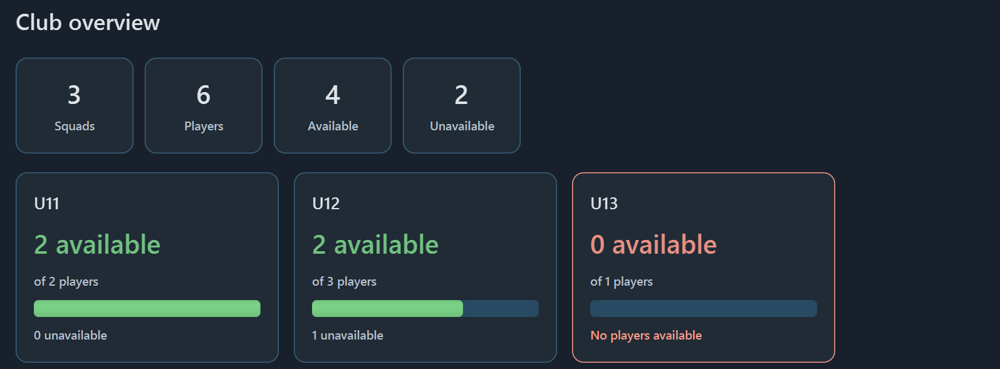

SquadLink is a **desktop application for coaches of small youth football clubs to manage players across multiple squads**.
It combines a Command Line Interface (CLI) with a Graphical User Interface (GUI) so you can manage player profiles,
check squad availability, and navigate views by typing commands.

* Table of Contents
{:toc}

--------------------------------------------------------------------------------------------------------------------

## Quick start

1. Ensure that Java `25` or later is installed on your computer. 
   **Mac users:** Ensure you have the precise JDK version prescribed [here](https://se-education.org/guides/tutorials/javaInstallationMac.html).

1. Download `squadlink.jar` from the [SquadLink Releases page](https://github.com/AY2627S1-CS2103T-F11-3/tp/releases).

1. Copy the file to the folder you want to use as the _home folder_ for your SquadLink.

1. Open a terminal, `cd` to the folder containing the JAR file, and run `java -jar squadlink.jar`. 
   A GUI similar to the one below should appear in a few seconds. Note how the app contains some sample data. 
   

1. Type a command in the command box and press Enter to execute it. For example, type **`help`** and press Enter to open the help window. 
   Some example commands you can try:

   * `list` : Shows all players and clears any current search or filter.

   * `overview` : Shows squad cards and club-wide player availability.

   * `main` : Returns to the main player list, keeping the current search, filter, and sort order.

   * `sort squad` : Sorts the displayed players by squad.

   * `add n/John Doe sn/Soccer Stars pos/Goalkeeper` : Adds a player named `John Doe`.

     For `add`, you can use `name/John Doe` instead of `n/John Doe`.

   * `delete 3` : Deletes the 3rd player shown in the current list.

   * `clear` : Deletes all players.

   * `exit` : Exits the app.

1. Refer to the [Features](#features) section below for details of each command.

--------------------------------------------------------------------------------------------------------------------

## Features

**:information_source: Notes about the command format:** 

* Command words are case-insensitive, so `find`, `Find`, and `FIND` are equivalent. Prefixes are lowercase and
  case-sensitive; use `name/`, `squad/` and other prefixes ending in `/`. The supported prefixes and aliases are
  listed under each command.

* Words in `UPPER_CASE` are the parameters to be supplied by the user. 
  For example, in `add n/NAME`, replace `NAME` with a value such as `John Doe`.

* Items in square brackets are optional. 
  For example, `n/NAME [t/TAG]` can be used as `n/John Doe t/friend` or as `n/John Doe`.

* Items followed by `…`​ can appear zero or more times. 
  For example, `[t/TAG]…​` may be omitted, or written as `t/friend` or `t/friend t/family`.

* Parameters can be in any order. 
  For example, if the command specifies `n/NAME t/TAG`, `t/TAG n/NAME` is also acceptable.

* `help`, `list`, `exit`, `clear`, `main`, `overview`, `undo` and `redo` accept no parameters. 
  Extra arguments, such as `help 123`, are rejected with usage guidance.

* If you are using a PDF version of this document, be careful when copying and pasting commands that span multiple lines as space characters surrounding line-breaks may be omitted when copied over to the application.

### Viewing help: `help`

Shows a message explaining how to access the help page.

Format: `help`

### Adding a player profile: `add`

Adds a player. Name, squad and position are required; the other fields are optional.

Format: `add name/NAME squad/SQUAD_NAME position/POSITION [guardian/GUARDIAN_NAME] [contact/TELEPHONE_NUMBER] [availability/true|false|available|unavailable] [injury/fit|injured] [fee/paid|unpaid] [consent/received|pending] [t/TAG]…`

| Field | Full prefix | Shorthand |
| --- | --- | --- |
| Player name | `name/` | `n/` |
| Squad name | `squad/` | `sn/` |
| Position | `position/` | `pos/` |
| Guardian name | `guardian/` | `g/` |
| Guardian contact | `contact/` | `gc/` |
| Availability | `availability/` | `av/` |
| Injury status | `injury/` | `inj/` |
| Fee payment status | `fee/` | `f/` |
| Consent status | `consent/` | `c/` |

* Fields can appear in any order. Specify each once using either prefix; mixing aliases for the same field is rejected.
  Tags (`t/`) may be repeated.
* Player, squad and supplied guardian names must not be blank. They accept letters, digits, hyphens and whitespace;
  surrounding whitespace is removed and repeated whitespace becomes one space. Names remain case-sensitive.
* Choose one position: `Goalkeeper`, `Defender`, `Midfielder` or `Striker`. Case, whitespace and hyphens are ignored
  (for example, `goal-keeper` means `Goalkeeper`).
* Guardian name and contact can be supplied independently. Omitted details display as `Not provided`; supplied empty
  values are rejected. Guardian contact numbers must have eight digits, ignoring whitespace and hyphens (for example, `8123-4567`).
* Availability accepts `true`, `false`, `available`, or `unavailable`, ignoring case and whitespace, and defaults to
  `true`. The previous full prefix, `available/`, is also accepted for backwards compatibility.
* Injury status accepts ASCII `fit` or `injured`, ignoring case and surrounding whitespace, and defaults to
  `fit`. Empty or unsupported values, including `unknown` and Unicode look-alike letters, are rejected.
  The player table displays the value in the `Injury` column
  next to `Availability`; scroll horizontally if the column is outside the visible area.
* Injury status and availability are independent. Recording `injury/injured` does not mark a player unavailable;
  supply `av/false` as well if needed. Injury status does not affect the availability counts in `overview`.
* Fee payment accepts ASCII `paid` or `unpaid` and defaults to `unpaid`; consent accepts ASCII `received` or `pending`
  and defaults to `pending`. Both ignore case and surrounding whitespace, and reject empty or unsupported
  values, including `unknown` and Unicode look-alike letters.
  Specify each prefix once. They record the current fee payment and consent status, without amounts,
  payment periods or consent documents.
* Fee payment and consent appear as text in the `Fee payment` and `Consent` columns. Scroll horizontally
  on narrow windows to see these columns. They do not automatically change availability, injury status,
  or the counts in `overview`.
* Players with the same normalized name, squad and position are rejected as duplicates, regardless of other fields.
  The same name is allowed with a different squad or position.

Success displays `Player NAME added!`. Missing required fields are reported first; otherwise, the first invalid or
repeated field is reported from left to right.

Examples:

* `add name/John Doe squad/Soccer Stars position/Goalkeeper`
* `add n/Mike Ox sn/Football Fellas pos/Striker g/Long Ox gc/9999-9999 av/false t/captain`
* `add n/Alex Tan sn/U12 pos/Defender injury/injured av/false`
* `add n/Sam Lee sn/U12 pos/Midfielder fee/unpaid consent/pending`
* `add n/Lee Tan sn/U12 pos/Defender inj/fit f/paid c/received`

### Listing all players: `list`

Opens the main page and shows all registered players, clearing any current search or filter while keeping the current sort order.

Format: `list`

* Clears any active `find` or `filter` criteria and displays every registered player.
* Retains the currently applied `sort` order.
* Accepts no parameters. Providing arguments (such as `list 2`) is rejected with usage guidance.
* If no players are registered, the response includes an example `add` command to help you create your first player.
* Whenever the player table is empty, it displays guidance on using `list` to clear filters or adding a new player.
* To return from the overview while keeping your current search/filter results instead of resetting to all players, use [`main`](#returning-to-the-main-page-main).

Examples:
* `list`

### Returning to the main page: `main`

Returns to the main player list from the overview without changing the current filter, sort order, or indexes.

Format: `main`

* Use `main` to return to the player list you were viewing before `overview`.
* If already on the main page, the command keeps the current list and displays a confirmation.
* An empty player list remains empty, including when a search or filter has no matches.
  Use `list` to show all registered players if the current results are empty.
* The command does not change or save player data. Extra arguments are rejected with usage guidance.
* Use `list` instead when you want to clear the current filter and show every registered player.

Success displays `Main page displayed. Current filter, sort order, and indexes are preserved.`

Example workflow:

1. Enter `filter sn/Soccer Stars` to show only Soccer Stars players.
2. Enter `overview` to view availability across the whole club.
3. Enter `main` to return to the same Soccer Stars players with the same indexes.
4. Enter `list` if you want to show every registered player instead.

### Viewing squad availability: `overview`

Opens a scrollable card overview of every squad and the players available for selection.

Format: `overview`

* Shows the number of squads, total registered players, and club-wide available and unavailable counts.
* Lists each squad's total, available and unavailable player counts in alphabetical order.
* Flags squads with no available players with `No players available`.
* Includes all registered players, even those hidden by `find` or `filter`. Your previous player list, filter, sort
  order, and indexes are retained. Use `main` to return to that list, or `list` to show all players.
* Squad names remain case-sensitive, as with `filter`. Legacy players with squad `Unassigned` appear under that name.
* Squads are derived from registered players. A squad disappears from the overview when its last player is deleted.
* Counts are recalculated each time you run the command. An empty club shows guidance to add players.
* Extra arguments are rejected with usage guidance.
* Cards wrap into fewer columns on narrow windows. Long squad names wrap, and the panel scrolls vertically.
* Availability bars show the proportion of players available. Squads with nobody available show a red
  border and a text warning.
* `main` restores the player list shown before the `overview` command. `list` shows all players, while `find` and
  `filter` show matching players. Other successful player commands also display the player list.
* Use `main` to check indexes before editing or deleting. Those commands use the retained player list.
* `help` opens help while keeping the overview. Command errors return to the player list and show the error.

Example overview showing club totals and squad cards:

### Editing a player: `edit`

Edits an existing player in SquadLink.

Format: `edit INDEX [n/NAME] [squad/SQUAD_NAME] [position/POSITION] [guardian/GUARDIAN_NAME] [contact/TELEPHONE_NUMBER] [availability/true|false|available|unavailable] [injury/fit|injured] [fee/paid|unpaid] [consent/received|pending] [t/TAG]…​`

* Edits the player at the specified `INDEX`. The index refers to the index number shown in the displayed player list. The index **must be a positive integer** 1, 2, 3, …​
* At least one of the optional fields must be provided.
* The displayed player index is checked before errors in the edit fields are reported. For example, if only four
  players are displayed, both `edit 99` and `edit 99 n/123@` report an invalid player index. With a valid index,
  missing fields or invalid field values are reported instead. Rejected edits do not change player data.
* Existing values will be updated to the input values.
* Name, squad, position, guardian name, guardian contact, availability, injury status, fee payment, consent and tags
  can be edited with this command.
  Use `sn/`, `pos/`, `g/`, `gc/`, `av/`, `inj/`, `f/` and `c/` as shorthand for their respective full prefixes.
  Specify each field once, except tags; using both a field's full prefix and shorthand is rejected.
  The previous availability prefix, `available/`, is also accepted for backwards compatibility.
* Squad, position, guardian name, guardian contact and availability use the same validation as `add`. `Unassigned`
  is not a valid edited position. Supply `guardian/` or `contact/` without a value to remove that optional detail.
  Player phone number, email and address are no longer supported.
* When editing tags, all of the player's existing tags are removed; adding tags is not cumulative.
* To remove all of a player's tags, enter `t/` without a tag after it.
* Use `injury/fit` or `injury/injured` to update the recorded injury status. Values require ASCII letters, ignoring case and
  surrounding whitespace. Omit `injury/` to keep the existing status; use `injury/fit` to return to the default.
  Empty values and repeated `injury/` fields are rejected. Changing injury status does not change availability.
* Use `fee/paid|unpaid` and `consent/received|pending` to update either or both statuses.
  Values require ASCII letters and use the same validation as `add`. Omitted fields retain their current values; explicitly use
  `fee/unpaid` or `consent/pending` to return to the default statuses. Empty values and repeated prefixes are rejected.
  Updates preserve all other fields, including availability and injury status.

Examples:
*  `edit 1 n/John Doe` Edits the name of the 1st player to be `John Doe`.
*  `edit 2 n/Betsy Crower t/` Edits the name of the 2nd player to be `Betsy Crower` and clears all existing tags.
*  `edit 2 av/false` Marks the 2nd player as unavailable.
*  `edit 2 injury/fit` Records the 2nd player as fit, keeping their current availability.
*  `edit 2 injury/injured` Records the 2nd player as injured without changing availability.
*  `edit 2 fee/paid consent/received` Records payment and consent for the 2nd player.
*  `edit 2 fee/unpaid` Marks only the 2nd player's fee payment as unpaid.
*  `edit 2 inj/fit f/paid c/received` Updates injury, fee payment and consent using shorthand prefixes.
*  `edit 2 sn/Soccer Stars pos/Defender g/Jane Doe gc/8123-4567` updates the player's profile details.

### Updating player statuses in bulk: `mark`

Sets one status for one or more displayed players.

Format: `mark INDEX [INDEX]... STATUS/VALUE`

| Status | Prefix | Values |
| --- | --- | --- |
| Availability | `availability/` or `av/` | `true`, `false`, `available`, `unavailable` |
| Injury | `injury/` or `inj/` | `fit`, `injured` |
| Fees | `fee/` or `f/` | `paid`, `unpaid` |
| Consent | `consent/` or `c/` | `received`, `pending` |

* Put positive player indexes first, separated by spaces or tabs, followed by exactly one status prefix and value.
  The previous availability prefix, `available/`, is also accepted for backwards compatibility.
  Indexes refer to the currently displayed list, including after `find` or `filter`. From the overview, use `main`
  to check the retained player list before marking.
* Prefixes are lowercase. Values ignore case and surrounding whitespace. Repeated indexes count only once.
* Supply exactly one status prefix, even when using aliases. For example, `mark 1 f/paid fee/paid` is rejected.
* Only the selected status changes. For example, marking a player injured does not change their recorded availability.
* All indexes and the value are validated before any player changes. Invalid input leaves every player unchanged.
* The current search or filter remains active. Players who no longer match disappear, and remaining players are
  renumbered. Check the displayed indexes before the next command; use `list` to show everyone.
* Feedback lists updated players separately from players already at the requested status. If every selected player
  already has that status, it reports `No changes needed`.
* The command saves through the normal automatic-save process. If saving fails, player data is restored and an
  error is shown.

Examples:

* `mark 1 3 av/false` marks the first and third displayed players unavailable.
* `mark 1 2 injury/fit` records both displayed players as fit.
* `mark 2 4 fee/paid` records payment for the second and fourth displayed players.
* `mark 1 consent/received` records consent for the first displayed player.
* `mark 1 3 f/paid` records payment using the shorthand prefix.

To update several statuses, run separate commands, checking indexes between commands if a filter is active.

### Locating players by name: `find`

Finds players whose names contain any of the given keywords.

If no players match, the response suggests changing the search or using `list`. If no players are registered,
it gives an example `add` command instead.

Format: `find KEYWORD [MORE_KEYWORDS]`

* The search is case-insensitive; for example, `hans` matches `Hans`.
* Keyword order does not matter; for example, `Hans Bo` matches `Bo Hans`.
* The search considers only names.
* Only full words match; for example, `Han` does not match `Hans`.
* Players matching at least one keyword are returned (an `OR` search); for example, `Hans Bo` returns `Hans Gruber` and `Bo Yang`.

Examples:
* `find John` returns `john` and `John Doe`
* `find alex david` returns `Alex Yeoh`, `David Li` 
  

* A current sort order is retained; `find` changes which players are shown, not how they are ordered.

### Filtering players: `filter`

Displays registered players that match squad, availability, injury, fee payment, or consent criteria.
Squad matching ignores capitalization; if squad names differ only by capitalization, filtering shows players from both.

Format: `filter [squad/SQUAD_NAME] [availability/true|false|available|unavailable] [injury/fit|injured] [fee/paid|unpaid] [consent/received|pending]`

| Criterion | Full prefix | Shorthand | Supported values |
| --- | --- | --- | --- |
| Squad name | `squad/` | `sn/` | Non-blank text (letters, digits, hyphens, spaces) |
| Availability | `availability/` | `av/` | `true`, `false`, `available`, `unavailable` |
| Injury status | `injury/` | `inj/` | `fit`, `injured` |
| Fee payment status | `fee/` | `f/` | `paid`, `unpaid` |
| Consent status | `consent/` | `c/` | `received`, `pending` |

* Supply at least one criterion. Criteria can appear in any order, but each criterion can appear only once.
  Specifying both long and shorthand forms for the same criterion (such as `squad/` and `sn/`) is rejected. 
* Squad names must not be blank and may contain only letters, digits, hyphens, and whitespace. Squad matching is
  case-sensitive; surrounding whitespace is trimmed, and repeated internal whitespace is treated as a single space. 
* Availability accepts `true`, `false`, `available`, or `unavailable`, ignoring case and surrounding whitespace.
  `true` and `available` match players stored as `available`; `false` and `unavailable` match players stored as
  `unavailable`.
  The previous availability prefix, `available/`, is also accepted for backwards compatibility.
* Injury status accepts ASCII `fit` or `injured`, ignoring case and surrounding whitespace. 
* Fee payment accepts ASCII `paid` or `unpaid`, ignoring case and surrounding whitespace. 
* Consent accepts ASCII `received` or `pending`, ignoring case and surrounding whitespace. 
* When multiple criteria are supplied, a player must satisfy all of them (AND logic). If players are registered but none
  match, the result is `No matching players found. Change your search or filter, or use list to show all players.`
  If no players are registered, the result instead suggests adding the first player and provides an example command. 
* Results replace the currently displayed list and use consecutive indexes starting from 1. Those indexes can be used
  immediately with commands like `edit`, `mark`, and `delete`. 
* Unknown filter prefixes, empty values, and any text preceding the first prefix are rejected as invalid command format. 
* A current sort order is retained; `filter` changes which players are shown, not how they are ordered.

Examples:

- `filter squad/Soccer Stars`
- `filter availability/available`
- `filter injury/injured fee/unpaid`
- `filter sn/Soccer Stars av/true fee/paid consent/received`
- `filter sn/Football Fellas injury/fit av/false`
- `filter inj/fit f/paid c/received`

### Sorting displayed players: `sort`

Sorts the currently displayed players by one field. Sorting is case-insensitive and does not change saved player data.
Players with the same selected field are ordered by name. `available` players appear before `unavailable` players.

Format: `sort FIELD`

Supported fields: `name`, `squad`, `position`, `availability`, and `reset`.

* `sort` works on the current `list`, `find`, or `filter` results. The displayed indexes are updated to match the
  sorted order and can be used with index-based commands such as `edit`, `delete`, and `remark`.
* `find`, `filter`, and `list` retain the current sort order. `list` only clears the current search or filter.
* `sort reset` restores the original stored player order while keeping the current search or filter.
* A sort is not saved to the data file. Restarting SquadLink restores the stored player order.

Examples:
* `sort name`
* `filter sn/Soccer Stars av/true` followed by `sort position`
* `sort reset`

### Deleting players: `delete`

Deletes one or more players from SquadLink.

Formats:

* By displayed index: `delete INDEX [INDEX]...`
* By full name: `delete n/NAME[, NAME]...`

**Deleting by index**

* Separate indices with spaces or tabs. Each index refers to the currently displayed player list.
* All indices refer to the list before the command runs. Deleting one player does not shift the other requested targets.
* Repeated indices delete the same player only once. For example, `delete 2 02` deletes only player 2.
* If any argument is invalid or any index is outside the displayed list, no players are deleted.
  Malformed arguments (including zero and numbers too large to process) are reported together, in input order,
  with the valid range for the currently displayed list. For example, with four players displayed,
  `delete 1 a 3 4 unknown` reports `Invalid indices: 'a', 'unknown'. Enter whole-number indices from 1 to 4.
  No players deleted.` Once all arguments are valid positive integers, any index outside the displayed list
  produces an error showing the available range. If no players are displayed, use `list` first.
* Remaining players keep their relative order and are renumbered.
* The index **must be a positive integer** 1, 2, 3, …​

**Deleting by name**

* Use `n/` or `name/` once, followed by full names separated by commas.
  Both prefixes are lowercase, and the space after them is optional.
  Repeated prefixes, including using both aliases together, are rejected.
* Name matching searches all registered players, including players hidden by a filter.
* Matching ignores capitalization and surrounding whitespace, and treats repeated whitespace as a single space.
* Partial names do not match. If a name is missing or matches multiple players, nobody is deleted.
* If a name matches multiple players, the message shows every matching player's details with a number.
  The displayed list switches to those matches, including any previously hidden by a filter.
  Use `delete 1` to delete the first match, or `delete 1 2` to delete both of the first two matches.
  These numbers refer to the matching list; if you change the displayed list, use its new indices.
* If a batch contains an ambiguous name, none of the requested players are deleted. Only matches for the first
  ambiguous name are shown; submit any other intended deletions again after resolving that name.
* Repeating a name deletes that player only once.
* Do not mix index selectors with name selectors. After `n/`, numbers are names, not indices.
* Empty entries, such as `John Doe,,Amy Tan` or a trailing comma, are rejected.
* Commas always separate names; quotation marks do not escape them.
* Player names support letters, digits, hyphens and whitespace. Other punctuation is not supported.

Examples:

* `list` followed by `delete 2` deletes the 2nd player in SquadLink.
* `list` followed by `delete 2 4` deletes the players originally shown at indices 2 and 4.
* `find Betsy` followed by `delete 1` deletes the 1st player in the results of the `find` command.
* `delete 1 abc` reports a non-numeric index and deletes nobody.
* `delete n/John Doe, Amy Tan` deletes both players if each name identifies exactly one registered player.
* `delete name/John Doe, Amy Tan` does the same using the full prefix.
* `delete n/17` selects a player whose full name is `17`.

### Clearing all entries: `clear`

Removes all registered players from SquadLink.

Format: `clear`

### Undoing previous commands: `undo`

Reverts the previous command that modified player data.

Format: `undo`

* Reverses the most recent data-modifying command (such as `add`, `edit`, `delete`, `clear`, `remark` or `mark`).
* Commands that do not modify player data (such as `list`, `find`, `filter`, `sort`, `main`, `overview`, and `help`) cannot be undone and are skipped by `undo`.
* Multiple commands can be undone consecutively back to the initial state when the application started.
* Accepts no parameters. Extra arguments (such as `undo 1`) are rejected with usage guidance.
* If there are no previous commands to undo, SquadLink displays: `The previous command cannot be undone.`

Success displays `Undid the last command!`.

Examples:
* `delete 1` followed by `undo` (restores the deleted player).
* `mark 1 2 av/false` followed by `undo` (reverts both players to their previous availability).

### Redoing undone commands: `redo`

Reverses the most recent `undo` command, restoring the data changes.

Format: `redo`

* Re-applies the action of the last command reversed by `undo`.
* Multiple `undo` commands can be reversed with consecutive `redo` commands.
* If a new modifying command (such as `add`, `delete`, `edit`, or `mark`) is entered after an `undo`, the remaining redo history is cleared and can no longer be redone.
* Accepts no parameters. Extra arguments (such as `redo all`) are rejected with usage guidance.
* If there is no undone command to redo, SquadLink displays: `There is no undo to redo.`

Success displays `Redid the last undo!`.

Examples:
* `delete 1` followed by `undo` (restores player), followed by `redo` (deletes the player again).

### Exiting the program: `exit`

Exits the program.

Format: `exit`

### Saving the data

SquadLink automatically saves after successful commands that change player data. Read-only commands such as `list`,
`find`, `filter`, `sort`, `main` and `overview` do not write the data file. If saving fails, the app reports an error
and restores the player data in memory.

Older data files containing player phone numbers, emails and addresses can still be loaded. Those legacy fields are
ignored and omitted the next time the file is saved; player names and the remaining profile fields are retained.
Players in older files without squad or position receive the current `Unassigned` defaults.
Players in older files without an injury status receive `fit`. Previously saved `unknown` values are also
migrated to `fit`. Other invalid stored injury values are rejected. Injury status is saved automatically with
the other player details and retained when the application restarts.
Older files without fee payment or consent status default to `unpaid` and `pending`, respectively.
Previously saved `unknown` values are also migrated to these defaults. Both statuses are saved with the player
profile and retained across restarts. Other invalid stored status values are rejected as invalid data.

### Editing the data file

SquadLink data is saved automatically as a JSON file `data/addressbook.json`, relative to the working directory from which you launch the application. Advanced users are welcome to update data directly by editing that data file.

:exclamation: **Caution:**
If your changes make the data file invalid, SquadLink starts with an empty player list at the next run. The invalid file remains on disk until a command changes player data and saves successfully. Still, we recommend backing up the file before editing it. 
Furthermore, certain edits can cause SquadLink to behave in unexpected ways (e.g., if a value entered is outside of the acceptable range). Therefore, edit the data file only if you are confident that you can update it correctly.

### Archiving data files `[coming in v2.0]`

_Details coming soon ..._

--------------------------------------------------------------------------------------------------------------------

## FAQ

**Q**: How do I transfer my data to another computer? 
**A**: Install the app on the other computer and overwrite the data file it creates with the data file from your previous SquadLink home folder.

--------------------------------------------------------------------------------------------------------------------

## Known issues

1. **When using multiple screens**, if you move the application to a secondary screen, and later switch to using only the primary screen, the GUI will open off-screen. The remedy is to delete the `preferences.json` file created by the application before running the application again.
2. **If you minimize the Help Window** and then run the `help` command (or use the `Help` menu, or the keyboard shortcut `F1`) again, the original Help Window will remain minimized, and no new Help Window will appear. The remedy is to manually restore the minimized Help Window.

--------------------------------------------------------------------------------------------------------------------

## Command summary

Action | Format, Examples
--------|------------------
**Add** | `add name/NAME squad/SQUAD position/POSITION [guardian/GUARDIAN] [contact/CONTACT] [availability/true\|false\|available\|unavailable] [injury/fit\|injured] [fee/paid\|unpaid] [consent/received\|pending] [t/TAG]…`   Aliases: `n/`, `sn/`, `pos/`, `g/`, `gc/`, `av/`, `inj/`, `f/`, `c/`   e.g., `add n/James Ho sn/Soccer Stars pos/Striker injury/fit`
**Clear** | `clear`
**Mark status** | `mark INDEX [INDEX]... STATUS/VALUE`  Choose one: `av/true\|false\|available\|unavailable`, `injury/fit\|injured`, `fee/paid\|unpaid`, `consent/received\|pending`  Aliases: `availability/`, `inj/`, `f/`, `c/`  e.g., `mark 1 3 f/paid`
**Delete** | `delete INDEX [INDEX]...` or `delete n/NAME[, NAME]...`  e.g., `delete 1 3` or `delete n/John Doe, Amy Tan`
**Edit** | `edit INDEX [n/NAME] [squad/SQUAD_NAME] [position/POSITION] [guardian/GUARDIAN_NAME] [contact/TELEPHONE_NUMBER] [availability/true\|false\|available\|unavailable] [injury/fit\|injured] [fee/paid\|unpaid] [consent/received\|pending] [t/TAG]…​`  Aliases: `sn/`, `pos/`, `g/`, `gc/`, `av/`, `inj/`, `f/`, `c/`  e.g., `edit 2 inj/injured av/false`
**Find** | `find KEYWORD [MORE_KEYWORDS]`  e.g., `find James Jake`
**Filter** | `filter [squad/SQUAD_NAME] [availability/true\|false\|available\|unavailable] [injury/fit\|injured] [fee/paid\|unpaid] [consent/received\|pending]` (at least one criterion required)  Aliases: `sn/`, `av/`, `inj/`, `f/`, `c/`   e.g., `filter sn/Soccer Stars av/true injury/fit fee/paid`
**Sort** | `sort name\|squad\|position\|availability\|reset`  e.g., `sort squad`
**List** | `list` (show all registered players, clear the current search or filter, and retain the sort order)
**Undo** | `undo` (revert the most recent data-modifying command) |
**Redo** | `redo` (reverse the most recent undo command) |
**Main** | `main` (return to the main player list and preserve the current search, filter, sort order, and indexes)
**Overview** | `overview`
**Help** | `help`
**Exit** | `exit`
