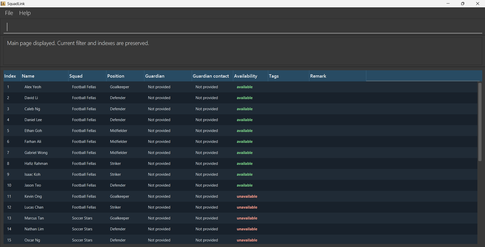
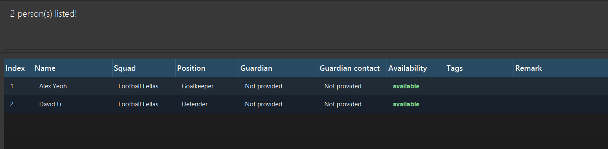

SquadLink is a **desktop application for coaches managing youth football players across multiple squads, optimized for use through a Command Line Interface (CLI)** while retaining the benefits of a Graphical User Interface (GUI). If you type quickly, SquadLink can help you manage player profiles faster than traditional GUI applications.

* Table of Contents
{:toc}

--------------------------------------------------------------------------------------------------------------------

## Quick start

1. Ensure that Java `25` or later is installed on your computer. 
   **Mac users:** Ensure you have the precise JDK version prescribed [here](https://se-education.org/guides/tutorials/javaInstallationMac.html).

1. Download `squadlink.jar` from the [SquadLink Releases page](https://github.com/AY2627S1-CS2103T-F11-3/tp/releases).

1. Copy the file to the folder you want to use as the _home folder_ for your SquadLink.

1. Open a terminal, `cd` to the folder containing the JAR file, and run `java -jar squadlink.jar`. 
   A GUI similar to the one below should appear in a few seconds. Note how the app contains some sample data. 
   

1. Type a command in the command box and press Enter to execute it. For example, type **`help`** and press Enter to open the help window. 
   Some example commands you can try:

   * `list` : Lists all players.

   * `add n/John Doe sn/Soccer Stars pos/Goalkeeper` : Adds a player named `John Doe`.

     For `add`, you can use `name/John Doe` instead of `n/John Doe`.

   * `delete 3` : Deletes the 3rd player shown in the current list.

   * `clear` : Deletes all players.

   * `exit` : Exits the app.

1. Refer to the [Features](#features) section below for details of each command.

--------------------------------------------------------------------------------------------------------------------

## Features

**:information_source: Notes about the command format:** 

* Command words and prefixes are lowercase and case-sensitive. Use `name/`, `squad/` and other
  prefixes ending in `/`; the supported prefixes and aliases are listed under each command.

* Words in `UPPER_CASE` are the parameters to be supplied by the user. 
  For example, in `add n/NAME`, replace `NAME` with a value such as `John Doe`.

* Items in square brackets are optional. 
  For example, `n/NAME [t/TAG]` can be used as `n/John Doe t/friend` or as `n/John Doe`.

* Items followed by `…`​ can appear zero or more times. 
  For example, `[t/TAG]…​` may be omitted, or written as `t/friend` or `t/friend t/family`.

* Parameters can be in any order. 
  For example, if the command specifies `n/NAME t/TAG`, `t/TAG n/NAME` is also acceptable.

* Extraneous parameters for commands that take no parameters, such as `help`, `list`, `exit`, and `clear`, are ignored. 
  For example, `help 123` is interpreted as `help`.

* If you are using a PDF version of this document, be careful when copying and pasting commands that span multiple lines as space characters surrounding line-breaks may be omitted when copied over to the application.

### Viewing help: `help`

Shows a message explaining how to access the help page.

Format: `help`

### Adding a player profile: `add`

Adds a player. Name, squad and position are required; the other fields are optional.

Format: `add name/NAME squad/SQUAD_NAME position/POSITION [guardian/GUARDIAN_NAME] [contact/TELEPHONE_NUMBER] [available/true|false] [t/TAG]…`

| Field | Full prefix | Shorthand |
| --- | --- | --- |
| Player name | `name/` | `n/` |
| Squad name | `squad/` | `sn/` |
| Position | `position/` | `pos/` |
| Guardian name | `guardian/` | `g/` |
| Guardian contact | `contact/` | `gc/` |
| Availability | `available/` | `av/` |

* Fields can appear in any order. Specify each once using either prefix; mixing aliases for the same field is rejected.
  Tags (`t/`) may be repeated.
* Player, squad and supplied guardian names must not be blank. They accept letters, digits, hyphens and whitespace;
  surrounding whitespace is removed and repeated whitespace becomes one space. Names remain case-sensitive.
* Choose one position: `Goalkeeper`, `Defender`, `Midfielder` or `Striker`. Case, whitespace and hyphens are ignored
  (for example, `goal-keeper` means `Goalkeeper`).
* Guardian name and contact can be supplied independently. Omitted details display as `Not provided`; supplied empty
  values are rejected. Contacts must have eight digits, ignoring whitespace and hyphens (for example, `8123-4567`).
* Availability accepts `true` or `false`, ignoring case and whitespace, and defaults to `true`.
* Players with the same normalized name, squad and position are rejected as duplicates, regardless of other fields.
  The same name is allowed with a different squad or position.

Success displays `Player NAME added!`. Missing required fields are reported first; otherwise, the first invalid or
repeated field is reported from left to right.

Examples:

* `add name/John Doe squad/Soccer Stars position/Goalkeeper`
* `add n/Mike Ox sn/Football Fellas pos/Striker g/Long Ox gc/9999-9999 av/false t/captain`

### Listing all players: `list`

Shows a list of all players in the player roster.

Format: `list`

### Editing a player: `edit`

Edits an existing player in the player roster.

Format: `edit INDEX [n/NAME] [t/TAG]…​`

* Edits the player at the specified `INDEX`. The index refers to the index number shown in the displayed player list. The index **must be a positive integer** 1, 2, 3, …​
* At least one of the optional fields must be provided.
* Existing values will be updated to the input values.
* Only name and tags can be edited with this command. Use `n/` for the name; `name/` is not supported by `edit`. Squad, position, guardian details and availability cannot be edited directly. To replace those fields, record the existing details, delete the player, then add the corrected profile.
* When editing tags, all of the player's existing tags are removed; adding tags is not cumulative.
* To remove all of a player's tags, enter `t/` without a tag after it.

Examples:
*  `edit 1 n/John Doe` Edits the name of the 1st player to be `John Doe`.
*  `edit 2 n/Betsy Crower t/` Edits the name of the 2nd player to be `Betsy Crower` and clears all existing tags.

### Locating players by name: `find`

Finds players whose names contain any of the given keywords.

Format: `find KEYWORD [MORE_KEYWORDS]`

* The search is case-insensitive; for example, `hans` matches `Hans`.
* Keyword order does not matter; for example, `Hans Bo` matches `Bo Hans`.
* The search considers only names.
* Only full words match; for example, `Han` does not match `Hans`.
* Persons matching at least one keyword are returned (an `OR` search); for example, `Hans Bo` returns `Hans Gruber` and `Bo Yang`.

Examples:
* `find John` returns `john` and `John Doe`
* `find alex david` returns `Alex Yeoh`, `David Li` 
  

### Filtering players: `filter`

Displays registered players that match a squad, availability, or both.

Formats:

* `filter squad/SQUAD_NAME [available/true|false]`
* `filter available/true|false [squad/SQUAD_NAME]`

Short forms are also accepted: `sn/SQUAD_NAME` for `squad/SQUAD_NAME`, and `av/true` or `av/false`
for `available/true|false`.

* Supply at least one criterion. Criteria can appear in either order, but each criterion can appear only once.
  Long and short forms count as the same criterion.
* Squad names must not be blank and may contain only letters, digits, hyphens and whitespace. Squad matching is
  case-sensitive; surrounding whitespace is ignored and repeated whitespace is treated as a single space.
* Availability accepts `true` or `false`, ignoring case and surrounding whitespace. `true` matches players stored
  as `available`; `false` matches players stored as `unavailable`.
* When both criteria are supplied, a player must satisfy both. If no players match, the result is
  `No matching players found!`.
* Results replace the currently displayed list and use its normal consecutive indexes. Those indexes can be used
  immediately with `delete`.
* Unknown filter prefixes and text before the first criterion are rejected as an invalid command format.

Examples:

* `filter squad/Soccer Stars`
* `filter available/true`
* `filter available/true squad/Football Fellas`
* `filter sn/Soccer Stars av/false`

### Deleting players: `delete`

Deletes one or more players from the player roster.

Formats:

* By displayed index: `delete INDEX [INDEX]...`
* By full name: `delete n/NAME[, NAME]...`

**Deleting by index**

* Separate indices with spaces or tabs. Each index refers to the currently displayed player list.
* All indices refer to the list before the command runs. Deleting one player does not shift the other requested targets.
* Repeated indices delete the same player only once. For example, `delete 2 02` deletes only player 2.
* If any argument is invalid or any index is outside the displayed list, no players are deleted.
  The error identifies the invalid index and the available range. If no players are displayed, use `list` first.
* Remaining players keep their relative order and are renumbered.
* The index **must be a positive integer** 1, 2, 3, …​

**Deleting by name**

* Use `n/` or `name/` once, followed by full names separated by commas.
  Both prefixes are lowercase, and the space after them is optional.
  Repeated prefixes, including using both aliases together, are rejected.
* Name matching searches all registered players, including players hidden by a filter.
* Matching ignores capitalization and surrounding whitespace, and treats repeated whitespace as a single space.
* Partial names do not match. If a name is missing or matches multiple players, nobody is deleted.
* If a name matches multiple players, the message shows every matching player's details with a number.
  The displayed list switches to those matches, including any previously hidden by a filter.
  Use `delete 1` to delete the first match, or `delete 1 2` to delete both of the first two matches.
  These numbers refer to the matching list; if you change the displayed list, use its new indices.
* If a batch contains an ambiguous name, none of the requested players are deleted. Only matches for the first
  ambiguous name are shown; submit any other intended deletions again after resolving that name.
* Repeating a name deletes that player only once.
* Do not mix index selectors with name selectors. After `n/`, numbers are names, not indices.
* Empty entries, such as `John Doe,,Amy Tan` or a trailing comma, are rejected.
* Commas always separate names; quotation marks do not escape them.
* Player names support letters, digits, hyphens and whitespace. Other punctuation is not supported.

Examples:

* `list` followed by `delete 2` deletes the 2nd player in the player roster.
* `list` followed by `delete 2 4` deletes the players originally shown at indices 2 and 4.
* `find Betsy` followed by `delete 1` deletes the 1st player in the results of the `find` command.
* `delete 1 abc` reports a non-numeric index and deletes nobody.
* `delete n/John Doe, Amy Tan` deletes both players if each name identifies exactly one registered player.
* `delete name/John Doe, Amy Tan` does the same using the full prefix.
* `delete n/17` selects a player whose full name is `17`.

### Clearing all entries: `clear`

Clears all entries from the player roster.

Format: `clear`

### Exiting the program: `exit`

Exits the program.

Format: `exit`

### Saving the data

SquadLink automatically saves after successful commands that change player data. Read-only commands such as `list`, `find` and `filter` do not write the data file. If saving fails, the app reports an error and restores the player data in memory.

Older data files containing player phone numbers, emails and addresses can still be loaded. Those legacy fields are
ignored and omitted the next time the file is saved; player names and the remaining profile fields are retained.
Players in older files without squad or position receive the current `Unassigned` defaults.

### Editing the data file

SquadLink data is saved automatically as a JSON file `data/addressbook.json`, relative to the working directory from which you launch the application. Advanced users are welcome to update data directly by editing that data file.

:exclamation: **Caution:**
If your changes make the data file invalid, SquadLink starts with an empty player roster at the next run. The invalid file remains on disk until a command changes player data and saves successfully. Still, we recommend backing up the file before editing it. 
Furthermore, certain edits can cause SquadLink to behave in unexpected ways (e.g., if a value entered is outside of the acceptable range). Therefore, edit the data file only if you are confident that you can update it correctly.

### Archiving data files `[coming in v2.0]`

_Details coming soon ..._

--------------------------------------------------------------------------------------------------------------------

## FAQ

**Q**: How do I transfer my data to another computer? 
**A**: Install the app on the other computer and overwrite the data file it creates with the data file from your previous SquadLink home folder.

--------------------------------------------------------------------------------------------------------------------

## Known issues

1. **When using multiple screens**, if you move the application to a secondary screen, and later switch to using only the primary screen, the GUI will open off-screen. The remedy is to delete the `preferences.json` file created by the application before running the application again.
2. **If you minimize the Help Window** and then run the `help` command (or use the `Help` menu, or the keyboard shortcut `F1`) again, the original Help Window will remain minimized, and no new Help Window will appear. The remedy is to manually restore the minimized Help Window.

--------------------------------------------------------------------------------------------------------------------

## Command summary

Action | Format, Examples
--------|------------------
**Add** | `add name/NAME squad/SQUAD position/POSITION [guardian/GUARDIAN] [contact/CONTACT] [available/true\|false] [t/TAG]…`   Aliases: `n/`, `sn/`, `pos/`, `g/`, `gc/`, `av/`   e.g., `add n/James Ho sn/Soccer Stars pos/Striker`
**Clear** | `clear`
**Delete** | `delete INDEX [INDEX]...` or `delete n/NAME[, NAME]...`  e.g., `delete 1 3` or `delete n/John Doe, Amy Tan`
**Edit** | `edit INDEX [n/NAME] [t/TAG]…​`  e.g., `edit 2 n/James Lee`
**Find** | `find KEYWORD [MORE_KEYWORDS]`  e.g., `find James Jake`
**Filter** | `filter squad/SQUAD_NAME [available/true\|false]` or `filter available/true\|false [squad/SQUAD_NAME]`  Aliases: `sn/`, `av/`   e.g., `filter sn/Soccer Stars av/true`
**List** | `list`
**Help** | `help`
**Exit** | `exit`
